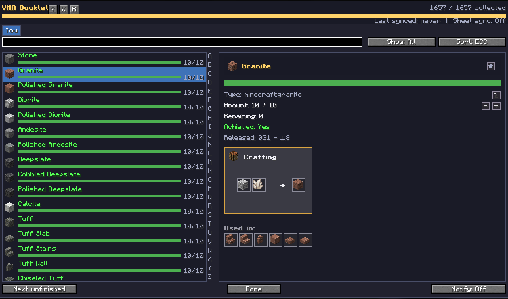
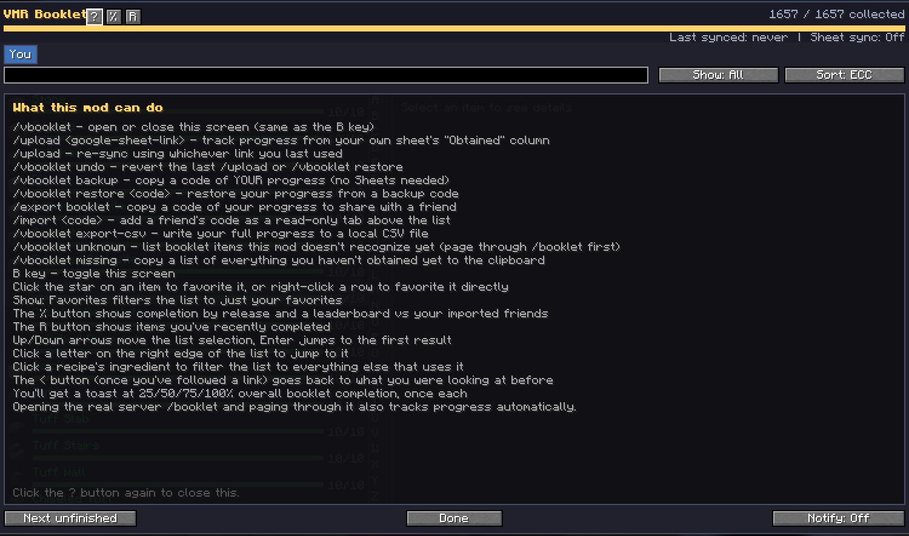
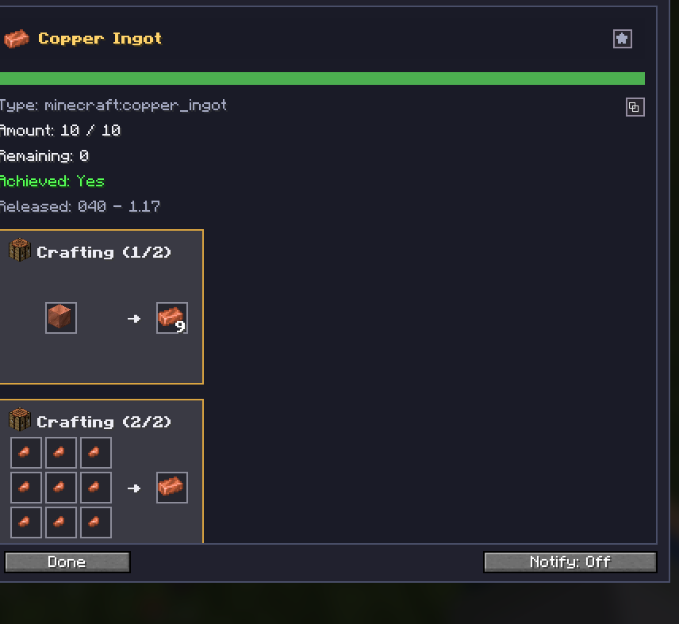
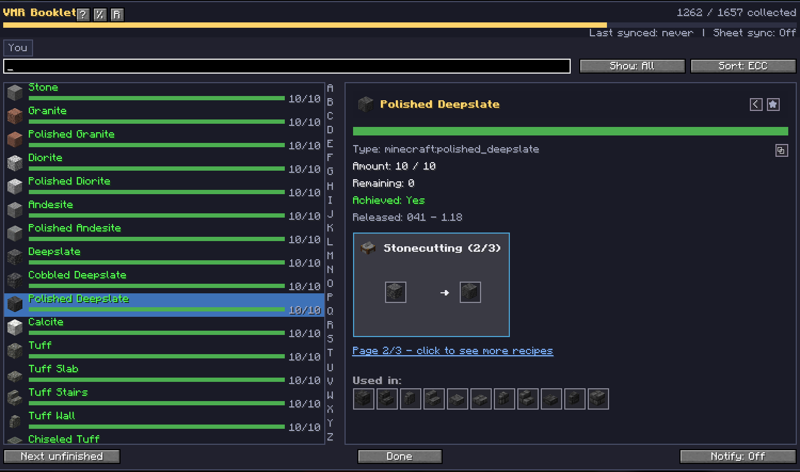
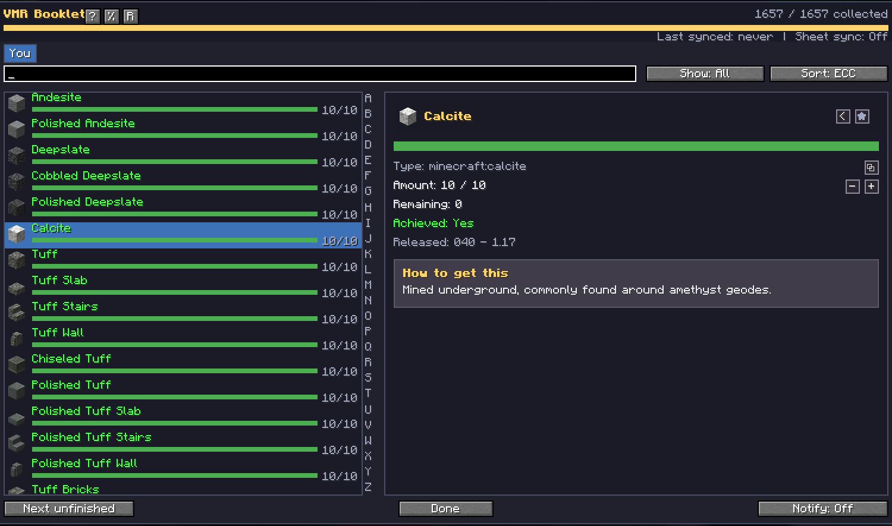

# VMR Booklet


A client-side Fabric mod that tracks your progress through the VMR Booklet
collection event (EcoCityCraft) - every vanilla Minecraft item, in one
searchable, filterable list, synced however you like.

**This mod is 100% client-side.** It never installs anything server-side,
never touches the real `/booklet` plugin, and works on any server (it's not
EcoCityCraft-specific beyond the `/sell` tracking feature).



## Requirements

- Minecraft 26.3
- Fabric Loader 0.19.5+
- Fabric API

## Install

Drop the built jar into your `.minecraft/mods` folder alongside Fabric
Loader and Fabric API.

## Opening the booklet

- Press **B** (rebindable in Controls → Key Binds)
- Or run `/vbooklet`

## Getting progress into it

Three ways, and you can use all three at once:

1. **Just play.** Open the real server's `/booklet` GUI and page through it -
   the mod reads it passively in the background. On EcoCityCraft, `/sell`
   while on the VMR server also counts automatically.
2. **`/upload <google-sheet-link>`** - pulls your sheet's "Obtained" column.
   Run `/upload` with no link to re-sync from whatever link you used last.
3. **Manual correction** - click an item in the booklet, then use the `-`/`+`
   buttons next to "Amount:" to nudge it by hand.

## Commands

| Command | What it does |
|---|---|
| `/vbooklet` | Open/close the booklet (same as B) |
| `/vbooklet undo` | Revert the last `/upload` or `/vbooklet restore` |
| `/vbooklet backup` | Copy a code of your own progress (no Sheets needed) |
| `/vbooklet restore [code]` | Restore your progress from a backup code (no arg = read from clipboard) |
| `/vbooklet export-csv` | Write your full progress to a local CSV file (`.minecraft/config/vmrbooklet/exports/`) |
| `/vbooklet missing` | Copy everything you haven't obtained yet to the clipboard |
| `/upload [link]` | Pull progress from a Google Sheet (no arg = re-sync last link) |
| `/export booklet` | Copy a share code of your progress for a friend |
| `/import [code]` | Add a friend's share code as a read-only tab (no arg = read from clipboard) |

Share and backup codes upload to [mclo.gs](https://mclo.gs) and give you a
short ~7-character id to send instead of the full code (which is too long to
paste into Minecraft's own chat box). If mclo.gs can't be reached, it falls
back to the full code automatically. mclo.gs keeps pastes for about 90 days -
not meant for long-term storage; use `/vbooklet export-csv` or a backup code
for that.

## In the booklet screen

- **Search** - type to filter by name
- **Show** - cycles All / Completed / Partial / Undiscovered / Favorites
- **Sort** - ECC order or Creative-menu order
- **A-Z rail** - jump the list straight to a letter without scrolling
- **Player tabs** - "You" plus any imported friends, each a read-only snapshot
- **Back button** - step back through items you've selected, browser-style
- **Star button** (in an item's detail panel) - toggle it as a favorite;
  "Show: Favorites" filters to just those
- **Copy button** - copies the item's display name (e.g. `Turtle_Scute`)
- **%  button** (top of the screen) - completion broken down by release version
- **Up/Down arrows** - move the list selection; **Enter** jumps to the first match
- **Next unfinished** - jumps to the next item you haven't completed
- **Notify** - toggles toast notifications when the live scanner picks up changes
- **Milestone toasts** - a one-time toast at 25% / 50% / 75% / 100% overall completion
- **Session counter** - how many items you've completed since launching the game

The in-game help screen (click the **?** button, or run `/vbooklet` again)
lists all of this in one place:



## Crafting recipes

Selecting an item shows its crafting recipe (if any) and what it's used in -
every known recipe, paginated, with the station it's made at (crafting table,
furnace, smithing table, stonecutter). Clicking an ingredient filters the
list down to everything else that uses it.




This is sourced from your client's own recipe-book data first, falling back
to a bundled copy of vanilla's own recipe data when that comes up empty
(which happens for recipes you haven't "unlocked" server-side, even if the
recipe is perfectly real - a known Minecraft client limitation this mod
works around). Where a recipe alone doesn't get you there - a dungeon drop,
a villager trade, a structure find - the detail panel also shows an
acquisition note explaining how to actually get it:



## Two-way Google Sheets sync (optional)

By default `/upload` is read-only (pulls from your sheet, never writes). To
also push your local progress back to your own sheet:

1. Create a Google Cloud project and a service account, download its JSON key
2. Save it as `.minecraft/config/vmrbooklet/service-account.json`
3. Share your Google Sheet with that service account's email (as an Editor)

Each player needs their own service account - the mod never bundles or
shares credentials. Without this set up, `/upload` just stays read-only.

## Mod Menu integration

If you have [Mod Menu](https://modrinth.com/mod/modmenu) installed, VMR
Booklet gets a settings screen from the mods list (toggle scan
notifications, set your sheet link, jump straight to the booklet). This is
entirely optional - the mod works the same without Mod Menu, just via
commands.

## Building from source

```
./gradlew build
```

Output jar lands in `build/libs/`. Requires JDK 25.

### Regenerating the bundled recipe data

`src/main/resources/data/vmrbooklet/booklet/static_recipes.json` is
generated once from the game's own `data/minecraft/recipe/*.json` and
`data/minecraft/tags/item/*.json` files - not hand-written. If you bump this
mod to a newer Minecraft version, regenerate it from that version's game jar
(see the generator logic referenced in `BookletStaticRecipeData`'s class
doc) and update the `__meta__.minecraftVersion` stamp it writes. The mod
logs a warning at startup if that stamp doesn't match the running game
version, so a missed regeneration won't fail silently.

## Contributing

Bug reports, QA, and feature requests are welcome via the issue templates -
see [CONTRIBUTING.md](CONTRIBUTING.md) for versioning and the release
process.
