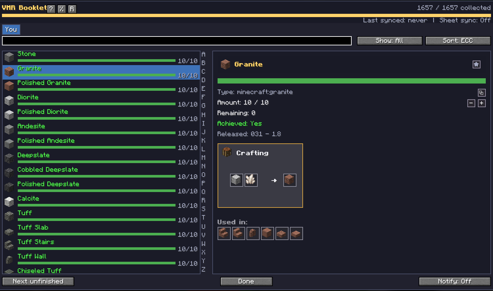
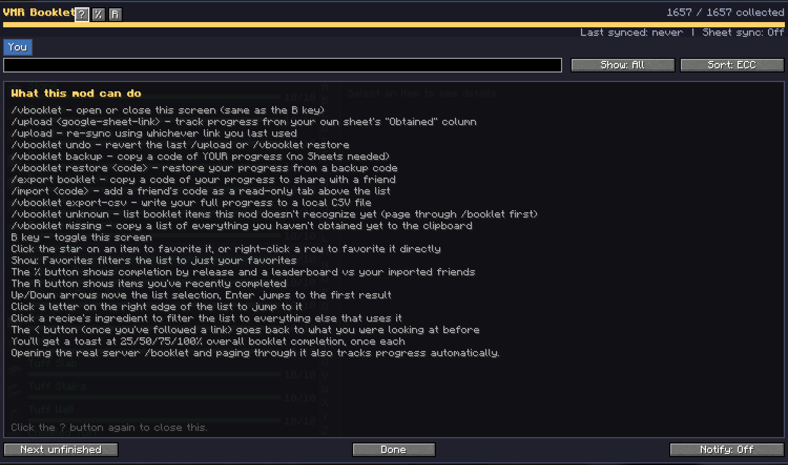
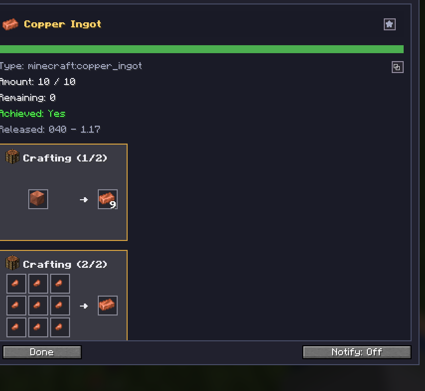
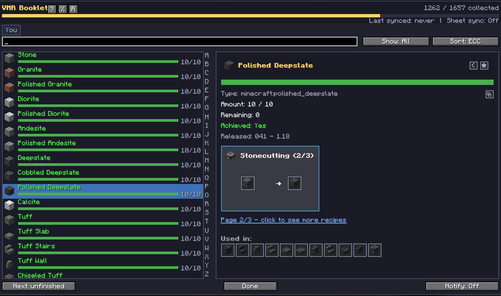
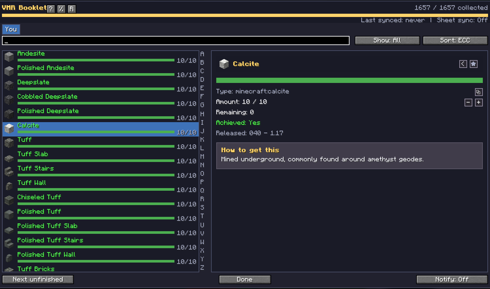

# VMR Booklet


A client-side Fabric mod that tracks your progress through the VMR Booklet
collection event (EcoCityCraft) - every vanilla Minecraft item, in one
searchable, filterable list, synced however you like.

**This mod is 100% client-side.** It never installs anything server-side,
never touches the real `/booklet` plugin, and works on any server (it's not
EcoCityCraft-specific beyond the `/sell` tracking feature).

<!-- TODO: refresh screenshots - current ones predate the T/N/F buttons and the streak line.
     Needed: overview (header with streak + six header buttons), the N (Needed tree) overlay,
     the F (Friends) overlay, the T (Timeline) overlay, and the updated ? help overlay. -->


## Requirements

- Minecraft 26.3
- Fabric Loader 0.19.5+
- Fabric API

## Install

Drop the built jar into your `.minecraft/mods` folder alongside Fabric
Loader and Fabric API.

## Opening the booklet

- Press **B** (rebindable in Controls → Key Binds)
- Or run `/vbooklet`
- Or hover any item in your inventory, a chest, or the creative tabs and press **B** -
  the booklet opens with that item selected

Close it with **B** (while the search box isn't focused), **Esc**, or the Done button.

## Getting progress into it

Three ways, and you can use all three at once:

1. **Just play.** Open the real server's `/booklet` GUI and page through it -
   the mod reads it passively in the background. On EcoCityCraft, `/sell`
   while on the VMR server also counts automatically.
2. **`/upload <google-sheet-link>`** - pulls your sheet's "Obtained" column.
   Run `/upload` with no link to re-sync from whatever link you used last.
3. **Manual correction** - click an item in the booklet, then use the `-`/`+`
   buttons next to "Amount:" to nudge it by hand.

## Commands

| Command | What it does |
|---|---|
| `/vbooklet` | Open the booklet (same as pressing B) |
| `/vbooklet undo` | Revert the last `/upload` or `/vbooklet restore` |
| `/vbooklet backup` | Copy a code of your own progress (no Sheets needed) |
| `/vbooklet restore [code]` | Restore your progress from a backup code (no arg = read from clipboard) |
| `/vbooklet unknown` | Tell you whether the live scanner has seen booklet items this mod doesn't recognize yet, and where the log file is |
| `/vbooklet export-csv` | Write your full progress to a local CSV file (`.minecraft/config/vmrbooklet/exports/`) |
| `/vbooklet missing` | Copy everything you haven't obtained yet to the clipboard |
| `/vbooklet missing notes` | Same, but with each item's acquisition note attached - an actual to-do list, not just names |
| `/vbooklet missing bycategory` | Same, grouped under a header line per category (Building Blocks, Redstone, Combat, ...) |
| `/vbooklet trades` | Copy a list of your missing items that an imported friend already has |
| `/vbooklet need <item>` | Copy a list of raw materials you still need to craft that item, walking its recipe chain |
| `/vbooklet goal <item>` | Pin/unpin an item to your current goal list (shown as a progress line in the booklet header) |
| `/vbooklet goal` | List your current goal list's items and their progress |
| `/vbooklet goal clear` | Empty your current goal list |
| `/vbooklet goal lists` | List every named goal list you have, with the active one marked |
| `/vbooklet goal list <name>` | Switch to a named goal list, creating it (empty) first if it doesn't exist yet |
| `/vbooklet goal delete <name>` | Delete a named goal list (the default list can only be cleared). List names ignore upper/lower case |
| `/vbooklet ready` | List items in your inventory that you still need, and which of them you're carrying enough of to finish right now |
| `/vbooklet note <item> <text>` | Save your own note for an item (shown in its detail panel) |
| `/vbooklet note <item> here` | Save where you're standing (coordinates + dimension) as that item's location |
| `/vbooklet note <item> clear` | Delete your note and saved location for an item; `/vbooklet note <item>` alone shows them |
| `/vbooklet card` | Save a shareable PNG progress card (overall %, streak, best categories) to `.minecraft/config/vmrbooklet/cards/` - click the file name in chat to open it |
| `/vbooklet reload` | Re-read the item list - see [Custom item lists](#custom-item-lists) |
| `/upload [link]` | Pull progress from a Google Sheet (no arg = re-sync last link). Pasting a friend's share code here imports it like `/import` |
| `/export` | Same as `/upload` with no argument - re-sync from your remembered sheet |
| `/export booklet` | Copy a share code of your progress for a friend |
| `/import [code]` | Add a friend's share code as a read-only tab (no arg = read from clipboard) |

Share and backup codes upload to [mclo.gs](https://mclo.gs) and give you a
short ~7-character id to send instead of the full code (which is too long to
paste into Minecraft's own chat box). If mclo.gs can't be reached, it falls
back to the full code automatically. mclo.gs keeps pastes for about 90 days -
not meant for long-term storage; use `/vbooklet export-csv` or a backup code
for that.

## In the booklet screen

- **Search** - type to filter by name, or combine filters:
  `@redstone` (category), `#1.21` (release), `!done` / `!todo` / `!partial` / `!new`,
  `>50%` / `<50%` (your progress on the item). Tokens of the same kind are OR'ed, different
  kinds AND'ed - e.g. `@combat !todo >0%` is every combat item you've started but not finished
- **Header buttons** - hover any of them for a short description
- **? button** - the in-game help overlay (shown automatically the first time you open the booklet)
- **Show** - left-click cycles All / Completed / Unfinished / Partial / Undiscovered / Favorites, right-click opens a dropdown to jump straight to one
- **Sort** - ECC order or Creative-menu order
- **Category** - left-click cycles the creative-menu categories, right-click opens a dropdown to jump straight to one
- **A-Z rail** - jump the list straight to a letter without scrolling
- **Player tabs** - "You" plus any imported friends, each a read-only snapshot
- **Back button** - step back through items you've selected, browser-style
- **Star button** (in an item's detail panel) - toggle it as a favorite;
  "Show: Favorites" filters to just those
- **Copy button** - copies the item's display name (e.g. `Turtle_Scute`)
- **% button** (top of the screen) - completion broken down by release version, plus a leaderboard against your imported friends
- **R button** (top of the screen) - items you've recently completed; click one to jump to it
- **T button** (top of the screen) - a day-by-day timeline of how many items you've completed
- **N button** (top of the screen) - what's still needed to craft the selected item, as a live expandable tree
- **F button** (top of the screen) - which of your imported friends already have each of your missing items
- **Up/Down arrows** - move the list selection; **Enter** jumps to the first match
- **/ or Ctrl+F** - jump straight to the search box without clicking it (an extra
  rebindable "Focus Booklet Search" key is in Controls, unbound by default)
- **B** (rebindable) - closes the booklet again while the search box isn't focused
- **H / S / R / T / N / F** - toggle the help, stats, recent, timeline, needed and friends
  overlays from the keyboard (while the search box isn't focused)
- **Esc** - closes whichever overlay is open first; press again to close the booklet
- **Clicking a row** in the R, N, or F overlay closes the overlay and jumps the list to that item
- **Next unfinished** - jumps to the next item you haven't completed
- **Notify** - toggles toast notifications when the live scanner picks up changes
- **Milestone toasts** - a one-time toast at 25% / 50% / 75% / 100% overall completion
- **Session counter** - how many items you've completed since launching the game
- **Streak counter** - how many days in a row (today or yesterday counts) you've completed at least one item
- **Goal progress** - how much of your active goal list is done (see `/vbooklet goal`)
- **Pace estimate** (in the % overlay) - your last 7 days' completion rate and roughly how many days that puts you from 100%
- **Your notes** - anything saved with `/vbooklet note` shows under the item's details

The session, streak, and goal parts of the header each only appear when there's something to show; the
streak and goal parts can be turned off in the Mod Menu settings.

The in-game help screen (click the **?** button) lists all of this in one place:



## Outside the booklet

These work anywhere in the game, each toggleable in the Mod Menu settings:

- **Tooltip line** - every booklet item's tooltip shows `Booklet: 3/5` (or `✓ Booklet`), plus
  `· Goal` if it's on your active goal list. On by default.
- **Highlight needed items** - container slots holding something you still need get a gold tint,
  so sorting loot shows what's worth keeping. Off by default; not applied to the creative tabs.
- **Goal HUD** - a small on-screen list of your active goal list with counts, in the corner you
  pick. Off by default.
- **Session summary** - a "+N items this session" toast (with your streak) when you close the
  booklet or leave a server, only when something new was completed since the last one.
- **Colorblind colors** - blue/orange/gray instead of green/yellow/gray everywhere, plus ✓ and ~
  marks on list rows so state never depends on color alone.

## Custom item lists

Put an `items.json` in `.minecraft/config/vmrbooklet/` and it replaces the bundled VMR list -
useful for any "collect these items" challenge on any server. It's a JSON array of objects;
only `id` is required:

```json
[
  { "id": "minecraft:diamond", "required": 64 },
  { "id": "minecraft:elytra", "name": "Elytra", "release": "1.9" }
]
```

Optional fields: `name` (defaults to the id, e.g. `Turtle_Scute`), `required` (default 1),
`release` (default `Custom`), `ecc_order` / `creative_order` (default: file order). Run
`/vbooklet reload` after editing it; if the file can't be read, the mod says so in chat and
falls back to the bundled list. Progress is stored by item id, so switching lists never loses
anything - items not on the active list are just ignored until you switch back. Share and
backup codes are disabled while a custom list is active (they encode positions in the bundled
list); use `/vbooklet export-csv` instead.

## Crafting recipes

Selecting an item shows its crafting recipe (if any) and what it's used in -
every known recipe, paginated, with the station it's made at (crafting table,
furnace, smithing table, stonecutter). Clicking an ingredient filters the
list down to everything else that uses it.




This is sourced from your client's own recipe-book data first, falling back
to a bundled copy of vanilla's own recipe data when that comes up empty
(which happens for recipes you haven't "unlocked" server-side, even if the
recipe is perfectly real - a known Minecraft client limitation this mod
works around). Where a recipe alone doesn't get you there - a dungeon drop,
a villager trade, a structure find - the detail panel also shows an
acquisition note explaining how to actually get it:



## Two-way Google Sheets sync (optional)

By default `/upload` is read-only (pulls from your sheet, never writes). To
also push your local progress back to your own sheet:

1. Create a Google Cloud project and a service account, download its JSON key
2. Save it as `.minecraft/config/vmrbooklet/service-account.json`
3. Share your Google Sheet with that service account's email (as an Editor)

Each player needs their own service account - the mod never bundles or
shares credentials. Without this set up, `/upload` just stays read-only.

## Mod Menu integration

If you have [Mod Menu](https://modrinth.com/mod/modmenu) installed, VMR
Booklet gets a settings screen from the mods list: scan notifications, the
header's streak and goal-progress parts, item tooltips, slot highlighting,
the goal HUD and its corner, session summary toasts, colorblind colors, your
sheet link, and a button to jump straight to the booklet. This is
entirely optional - the mod works the same without Mod Menu, just via
commands.

## Building from source

```
./gradlew build
```

Output jar lands in `build/libs/`. Requires JDK 25.

### Regenerating the bundled recipe data

`src/main/resources/data/vmrbooklet/booklet/static_recipes.json` is
generated once from the game's own `data/minecraft/recipe/*.json` and
`data/minecraft/tags/item/*.json` files - not hand-written. If you bump this
mod to a newer Minecraft version, regenerate it from that version's game jar
(see the generator logic referenced in `BookletStaticRecipeData`'s class
doc) and update the `__meta__.minecraftVersion` stamp it writes. The mod
logs a warning at startup if that stamp doesn't match the running game
version, so a missed regeneration won't fail silently.

## Translations

Every piece of text the mod shows lives in
`src/main/resources/assets/vmrbooklet/lang/en_us.json`. To add a language,
copy that file to the matching Minecraft locale name (e.g. `de_de.json`,
`es_es.json`), translate the values, and open a pull request. Category names
already use Minecraft's own creative-tab translations.

## Contributing

Bug reports, QA, and feature requests are welcome via the issue templates -
see [CONTRIBUTING.md](CONTRIBUTING.md) for versioning and the release
process.
